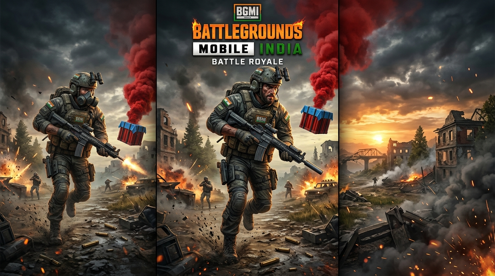

# 🎮 BGMI APK Pro - High-CTR Gaming & APK Download WordPress Theme

<p align="center">
  
</p>

<p align="center">
  <strong>An ultra-fast, SEO-optimized, and high-converting WordPress Theme & Landing Portal inspired by <a href="https://bgminewapk.com/">bgminewapk.com</a>.</strong><br>
  Specially engineered for Battlegrounds Mobile India (BGMI), Free Fire India, and Android Gaming APK & OBB download niches with maximum Google AdSense CTR.
</p>

<p align="center">
  
  
  
  
  
  
</p>

---

## 📌 Project Overview (Ye Project Kya Hai?)

**BGMI APK Pro** ek modern, production-ready WordPress theme aur standalone web template hai jise specially Android Gaming APK download websites ke liye design kiya gaya hai. 

Isme standard boring blogs ke mukable **gaming industry ki best UI/UX practices** aur **high ad conversion layouts** shaamil hain:
- ✅ **Higher Page Engagement**: 10-Second interactive countdown timer jo user ko page par hold karta hai aur bounce rate kam karta hai.
- ✅ **AdSense Optimized Slots**: 5+ strategic ad placements (Header Leaderboard, In-feed cards, In-article top & bottom, Inside Download Timer, Sticky Sidebar).
- ✅ **Complete Technical Specs Box**: Har game ke liye APK Version, Size, OBB Data, OS Requirements, aur Play Store direct links.
- ✅ **Google Rich Snippet Schema**: `SoftwareApplication` aur `FAQPage` microdata pre-built hai taaki aapki site Google search me star ratings aur FAQs ke saath rank kare.

---

## ✨ Key Features (Mukhy Visheshatayein)

### 1. 🎨 Signature Aesthetic Design (Inspired by bgminewapk.com)
- **Deep Royal Purple Banners (`#5B12BE`)**: Header aur post heading banners me attractive purple gradients aur subtle drop shadows.
- **Electric Blue Action Buttons (`#0086FF`)**: Vibrant CTA download buttons with smooth hover animations aur soft glow effect.
- **Core Download Specification Card (`.box2`)**: Light ice-blue background (`#c0d7fc`) with border `#3280fc`, app icon, version badges, aur file details.
- **Alert & Notice Callouts (`.note` / `.note.wr`)**: Blue alert info boxes aur red warning callouts jo users ko important installation instructions batate hain.

### 2. ⏳ Interactive 10-Second Countdown Timer
Jab user *"Download BGMI 3.5 APK"* button par click karta hai:
1. Page smoothly timer par scroll hota hai.
2. Animated countdown timer shuru hota hai (`10... 9... 8...`).
3. Timer ke dauran ek high-impact native ad unit display hota hai.
4. Timer complete hote hi direct APK aur OBB high-speed download buttons reveal ho jaate hain.

### 3. 💰 Maximum Monetization (Google AdSense Ready)
Har page par ad blocks pre-designed hain jo Google AdSense policies ka 100% paalan karte hain bina user experience kharab kiye:
| Ad Slot | Size | Location |
| :--- | :--- | :--- |
| **Header Leaderboard** | 728x90 (Desktop) / 320x100 (Mobile) | Header ke theek niche |
| **In-Feed Native Ad** | Responsive Banner | Homepage ke 2nd post card ke baad |
| **In-Article Top Ad** | 728x90 / 300x250 | Article title aur featured image ke beech |
| **Download Timer Ad** | Responsive / 300x250 | Countdown timer ke andar (Highest CTR) |
| **Sticky Sidebar Banner**| 300x250 / 300x600 | Right sidebar scroll par sticky |
| **Post Bottom Banner** | 728x90 / Responsive | Article content ke theek baad |

### 4. 🔍 Complete SEO & Rich Snippets
- Built-in Schema.org JSON-LD structured data for Google Search.
- Step-by-step numbered guide layout for OBB installation (Google featured snippet target).
- Interactive FAQ Accordion widget.
- Clean semantic HTML5 and Montserrat + Outfit Google typography.

---

## 📂 File & Directory Structure

```
c:/Users/.../Desktop/Ads Site/
├── index.html                     # 🌐 Standalone live browser preview for Homepage
├── single-post.html               # 🎮 Standalone live browser preview for Download Page
├── server.js                      # ⚡ Zero-dependency local Node.js server (Port 3000)
├── README.md                      # 📖 Complete documentation & guide
├── .gitignore                     # 🛡️ Git ignore configuration
│
└── wp-theme-bgmi-apk/             # 📦 COMPLETE WORDPRESS THEME FOLDER
    ├── style.css                  # Theme definition, responsive CSS & animations
    ├── functions.php              # Custom meta boxes, shortcodes & theme setup
    ├── header.php                 # Sticky branding header, notice bar, search modal
    ├── footer.php                 # 3-column footer, DMCA notice box, back-to-top
    ├── index.php                  # 2-column post cards grid with pagination
    ├── single.php                 # Single game post, .box2 container, countdown timer
    ├── page.php                   # Page template for DMCA, Privacy Policy, About
    ├── sidebar.php                # Trending games, search widget, sticky ad unit
    ├── screenshot.png             # WordPress theme dashboard preview image
    └── assets/
        ├── images/
        │   ├── bgmi-banner.jpg    # High-res featured banner for BGMI
        │   ├── free-fire-banner.jpg # Featured banner for Free Fire India
        │   └── app-icon.jpg       # 3D helmet gaming app store icon
        └── js/
            └── main.js            # Countdown timer logic, modal, FAQ accordion
```

---

## 🚀 How to Run Locally (Apne Computer Par Kaise Chalayein)

Agar aap bina WordPress ke apne laptop/PC par turant iska design check karna chahte hain:

1. **Terminal / PowerShell open karein** aur is folder me jayein:
   ```bash
   node server.js
   ```
2. **Browser me ye URL kholein:**
   - **Home Page**: [http://localhost:3000/](http://localhost:3000/)
   - **Single Download Post**: [http://localhost:3000/single-post.html](http://localhost:3000/single-post.html)

*(Aap direct `index.html` ya `single-post.html` par double-click karke bhi kisi bhi browser me open kar sakte hain!)*

---

## 🛠️ How to Install on WordPress (WordPress Me Kaise Lagayein)

### Method A: Zip File Upload (Sabse Aasan)
1. `wp-theme-bgmi-apk` folder ko right click karke `.zip` file banayein (`wp-theme-bgmi-apk.zip`).
2. Apne WordPress Admin Dashboard me login karein.
3. Jayein: **Appearance > Themes > Add New > Upload Theme**.
4. Zip file choose karein aur **Install Now** par click karein.
5. Installation ke baad **Activate** par click karein.

### Method B: Direct FTP / File Manager Upload
1. `wp-theme-bgmi-apk` folder ko copy karein.
2. Apne hosting server par jayein: `/wp-content/themes/`.
3. Yahan paste karein aur WordPress Dashboard me jakar **Appearance > Themes** se activate karein.

---

## 📝 How to Add a New Game / APK Post in WordPress

Jab aap WordPress me **Posts > Add New** par jayenge, to content editor ke theek niche aapko ek naya section dikhega:
**"APK & Game Details (Custom Download Box)"**

Yahan aap direct fill kar sakte hain:
- **App / Game Name**: jaise `Battlegrounds Mobile India`
- **Current Version**: jaise `v3.5.0`
- **APK File Size**: jaise `74 MB`
- **OBB File Size**: jaise `650 MB`
- **Android OS Requirement**: jaise `Android 5.1.1 and up`
- **Developer**: jaise `KRAFTON, Inc.`
- **Rating**: jaise `4.8 ★`
- **Play Store Link**: Google Play store ki official link
- **Direct APK Download Link**: Aapka high-speed APK download link
- **Direct OBB Download Link**: Aapka OBB data file download link

Theme automatically aapka beautiful `.box2` container, countdown timer aur technical specs table generate kar degi!

---

## ⌨️ Useful Shortcodes

Aap post content likhte waqt ye shortcodes use kar sakte hain:

- **Blue Info Note Box**:
  ```markdown
  [note]Aapka informative note ya instruction yahan likhein.[/note]
  ```
- **Red Warning Note Box**:
  ```markdown
  [note type="warning"]Warning: Pehle OBB file copy karein fir game open karein.[/note]
  ```
- **In-Content Ad Slot**:
  ```markdown
  [ad_banner label="Sponsored Advertisement"]
  ```

---

## ⚖️ DMCA & Legal Compliance

Theme me pre-configured legal disclaimer add kiya gaya hai:
> *Battlegrounds Mobile India (BGMI) is a registered trademark of KRAFTON, Inc. This website is an independent community and educational portal. All game files, logos, and trademarks belong to their respective copyright owners.*

---

## 👨‍💻 Developer & Credits

- **Repository**: [https://github.com/aurav2001/ADs-Site](https://github.com/aurav2001/ADs-Site)
- **Author**: aurav2001
- **Inspired by**: [bgminewapk.com](https://bgminewapk.com/)
- **License**: GNU General Public License v2.0
